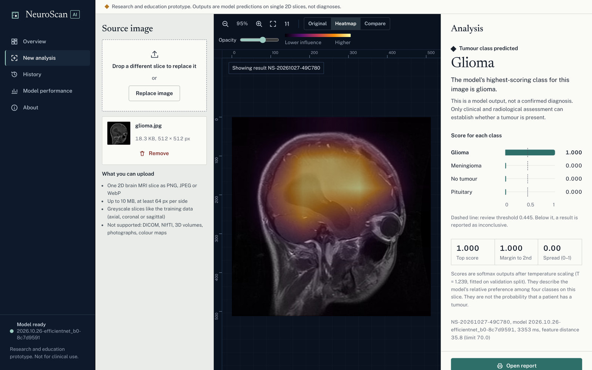
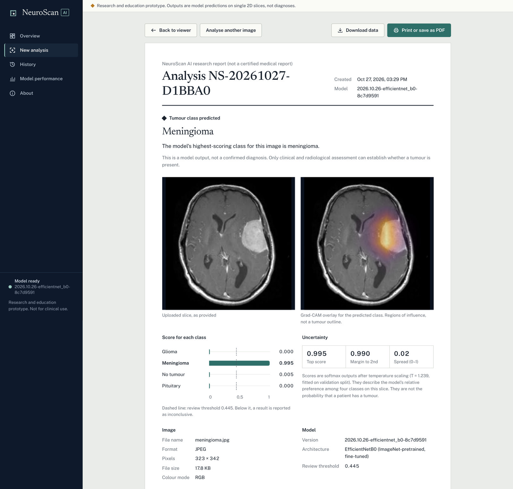
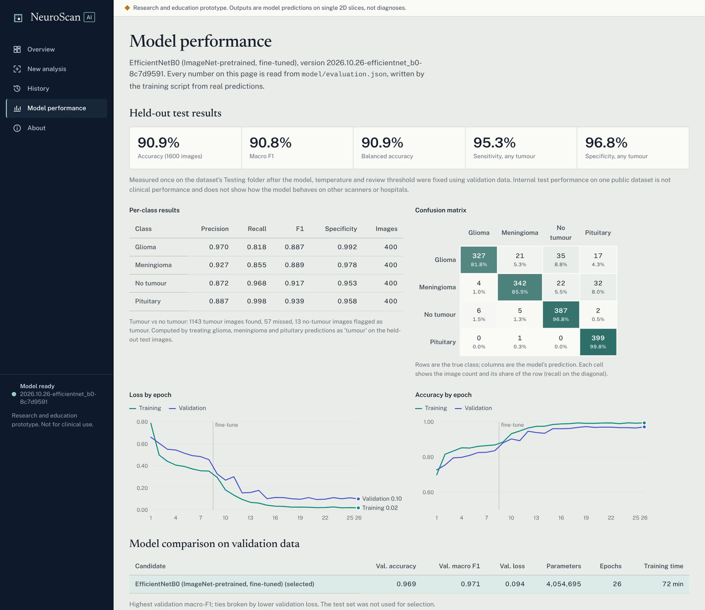
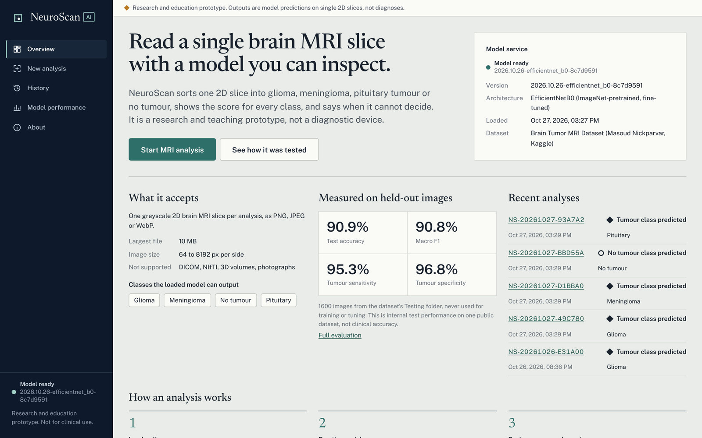
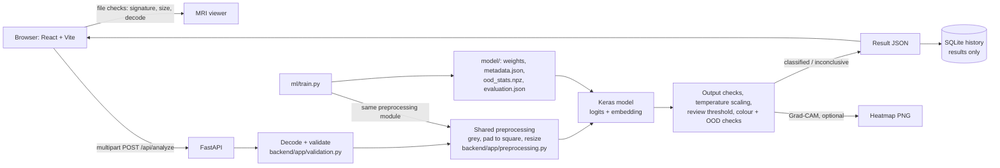

# NeuroScan AI

A research and teaching prototype that classifies a **single 2D brain MRI slice** as glioma, meningioma, pituitary tumour or no tumour, using a model you train locally. It shows the score for every class, says when it cannot decide, and explains its output with Grad-CAM.

> **Not a medical device.** NeuroScan has not been clinically validated. A "no tumour" output does not rule out a tumour. Do not use it to diagnose, treat or rule out any condition.



---

## Contents

- [Why this project](#why-this-project)
- [What it does](#what-it-does)
- [Screenshots](#screenshots)
- [Architecture](#architecture)
- [Results](#results)
- [Quick start on Windows (scripts)](#quick-start-on-windows-scripts)
- [Setup on Windows (manual)](#setup-on-windows-manual)
- [Running the app](#running-the-app)
- [Training and evaluating a model](#training-and-evaluating-a-model)
- [Testing](#testing)
- [API](#api)
- [Limitations and responsible use](#limitations-and-responsible-use)
- [Troubleshooting](#troubleshooting)
- [Project structure](#project-structure)
- [Acknowledgements](#acknowledgements)

## Why this project

Many "AI tumour detector" demos show confident labels for any image, including photographs, and report accuracy figures that cannot be traced to an experiment. This project is about the opposite: a classifier whose every number comes from a reproducible evaluation, whose preprocessing is identical in training and serving, and which refuses to answer when the input or the model's confidence does not support an answer.

## What it does

| Feature | Details |
|---|---|
| Upload | PNG, JPEG or WebP slice; checked by file contents (not extension), size, dimensions, corruption and decompression bombs. DICOM and NIfTI are rejected with instructions. |
| Viewer | Real pixels of your file, pixel rulers, cursor readout of image coordinates and grey value, zoom, pan, fit, 1:1, keyboard control. |
| Inference | FastAPI backend, model loaded once, readiness gate (metadata, weights hash, shapes, class count, smoke test) before analysis is enabled. |
| Result states | **Classified**, **Inconclusive** (low score, colour image, or atypical features) and **Unavailable/rejected**. A failure can never appear as "no tumour". |
| Scores | Temperature-scaled softmax for all classes, margin, entropy, and a review threshold chosen on validation data. |
| Explainability | Grad-CAM from the actual model and image, overlay or side-by-side compare with opacity control. Not a tumour outline. |
| Report | Printable report (Print or save as PDF) and JSON export, built only from the server's response. |
| History | Local SQLite of results only. Never the image, heatmap or file name. Search, filter, sort, detail view, delete. |
| Model performance | Test metrics, per-class table, confusion matrix, training curves, calibration, threshold behaviour, leakage checks. All read from `model/evaluation.json`; shows "Evaluation unavailable" otherwise. |

Classes come from the trained model's metadata. If a model were trained without a class, the app would not offer it.

## Screenshots

All screenshots show real output of the trained model (`2026.10.26-efficientnet_b0-8c7d9591`) on images from the dataset's held-out `Testing` folder.

| Printable report | Model performance |
|---|---|
|  |  |



## Architecture



More detail: [docs/architecture.md](docs/architecture.md). Model details and caveats: [docs/model-card.md](docs/model-card.md).

**Stack:** React 19, TypeScript, Vite (no UI framework; hand-built design system and SVG charts) · FastAPI, Pillow, NumPy · TensorFlow/Keras 3 · scikit-learn (splits, covariance) · pytest, Node test runner, Playwright (optional browser checks) · GitHub Actions.

## Results

Measured on a Windows laptop CPU (no GPU) with the Kaggle *Brain Tumor MRI Dataset* (7,200 images: 1,400 per class in `Training`, 400 per class in `Testing`). The tables below are generated from `model/evaluation.json` by `python -m ml.report_md`; the app's *Model performance* page shows the same file with charts.

**Published model:** `2026.10.26-efficientnet_b0-8c7d9591`, EfficientNetB0 (ImageNet weights, all layers fine-tuned), trained with `scripts\train.ps1 -FullFineTune`.

| Metric (held-out `Testing` folder, 1,600 images) | Value |
|---|---|
| Accuracy | **90.9%** |
| Macro F1 | 0.908 |
| Balanced accuracy | 90.9% |
| Tumour vs no tumour: sensitivity | **95.3%** (57 of 1,200 tumour images missed) |
| Tumour vs no tumour: specificity | **96.8%** (13 of 400 no-tumour images flagged) |
| Calibration error (ECE) after temperature scaling | 0.048 |

| Class | Precision | Recall | F1 | Specificity |
|---|---|---|---|---|
| Glioma | 0.970 | 0.818 | 0.887 | 0.992 |
| Meningioma | 0.927 | 0.855 | 0.889 | 0.978 |
| No tumour | 0.872 | 0.968 | 0.917 | 0.953 |
| Pituitary | 0.887 | 0.998 | 0.939 | 0.958 |

The most common error is a glioma or meningioma slice predicted as *no tumour* (57 of 1,600 images), which is the dangerous direction for a screening tool, and one more reason this is not one.

### How these numbers were obtained

| Run | Candidates (selection on validation data only) | Val. macro F1 | Test accuracy | CPU training time |
|---|---|---|---|---|
| 1. `scripts\train.ps1` | Baseline CNN from scratch (1.2 M parameters) | 0.910 | not tested (not selected) | 114 min |
| | EfficientNetB0, top 40 layers fine-tuned (selected) | 0.937 | 86.1% | 23 min |
| 2. `scripts\train.ps1 -FullFineTune` | EfficientNetB0, all layers fine-tuned (published) | **0.971** | **90.9%** | 72 min |

- **Leakage removed before training.** 115 training images were exact copies of test images and 672 were near-duplicates (256-bit dHash, Hamming distance ≤ 12); all 787 were removed, leaving 4,813 of 5,600 training images. Near-duplicate clusters are kept on one side of the train/validation split. Accuracy figures above 98% that are often quoted for this dataset usually come without this step.
- **Selection rule fixed in advance.** Run 2 was started after run 1's test result was known. Before it finished, the rule was set that it would replace run 1 only if its *validation* macro F1 was higher, whatever its test score. It was (0.971 vs 0.937). The test set has therefore been evaluated twice, once per run; nothing else was tuned on it.
- **Validation is easier than test.** Validation accuracy is 97% while test accuracy is 91%, so the review threshold chosen on validation (0.445, aiming at 97% accuracy on the images it keeps) flags only 0.1% of test images. On this dataset the colour and atypical-feature checks, not the threshold, do most of the abstaining.
- **Serving check.** After training, 24 test images were run through the backend's own decode, preprocessing and inference code; scores matched training-side scores to within 2.2 × 10⁻⁶.

These are internal results on one public dataset, not clinical performance.

## Quick start on Windows (scripts)

Prerequisites: **Python 3.11 or 3.12** (TensorFlow 2.21 supports 3.10–3.13 on Windows, CPU only), **Node.js 20+**, Git, and at least 8 GB RAM. No GPU needed.

Open the project folder in VS Code, then *Terminal → New Terminal* (PowerShell). Each step is one command:

```powershell
# 1. Install everything, run all tests, build the website (first time only)
powershell -ExecutionPolicy Bypass -File scripts\setup.ps1

# 2. Put the dataset in data\ (ignored by Git). Download the zip from Kaggle in your browser first:
#    https://www.kaggle.com/datasets/masoudnickparvar/brain-tumor-mri-dataset
powershell -ExecutionPolicy Bypass -File scripts\get-dataset.ps1 -Zip "$HOME\Downloads\archive.zip"

# 3. Train: quick pipeline check first, then the real model
powershell -ExecutionPolicy Bypass -File scripts\train.ps1 -Quick
powershell -ExecutionPolicy Bypass -File scripts\train.ps1

# 4. Start the site (opens http://localhost:8000). Ctrl+C stops it.
powershell -ExecutionPolicy Bypass -File scripts\start.ps1
```

The same steps are VS Code tasks: *Terminal → Run Task…* lists *Setup*, *Get dataset*, *Train model*, *Start NeuroScan AI* (also `Ctrl+Shift+B`), *Start in dev mode* and *Run all tests*. `scripts\test.ps1` runs every software test.

The manual commands the scripts run are below.

## Setup on Windows (manual)

Open PowerShell in the project folder (in VS Code: *Terminal → New Terminal*).

```powershell
# 1. Python environment
py -3.12 -m venv .venv
.\.venv\Scripts\Activate.ps1
# If activation is blocked: Set-ExecutionPolicy -Scope Process -ExecutionPolicy Bypass
python -m pip install --upgrade pip
pip install -r backend/requirements.txt -r ml/requirements.txt -r backend/requirements-dev.txt

# 2. Frontend
cd frontend
npm install
cd ..
```

TensorFlow is a large download (several hundred MB). `ml/requirements.txt` is needed both to train and to serve a trained model.

## Running the app

You need two terminals, both opened in the project folder.

**Terminal 1: backend**

```powershell
.\.venv\Scripts\Activate.ps1
uvicorn backend.app.main:app --port 8000
```

**Terminal 2: frontend**

```powershell
cd frontend
npm run dev
```

Open <http://localhost:5173>.

Without a trained model the app still runs: analysis is disabled, the status says *Model not ready*, and *About* lists which readiness check failed. That is intended. There is no fallback model and no simulated output.

**Single-process demo:** run `npm run build` inside `frontend`, then start only the backend and open <http://localhost:8000>.

API docs (OpenAPI) are at <http://localhost:8000/docs>.

## Training and evaluating a model

### 1. Get the dataset

Download **Brain Tumor MRI Dataset** by Masoud Nickparvar from Kaggle: <https://www.kaggle.com/datasets/masoudnickparvar/brain-tumor-mri-dataset>. Unzip it outside the repository, for example to `C:\data\brain-tumor-mri-dataset`, so that it contains:

```
C:\data\brain-tumor-mri-dataset\
├── Training\glioma\  meningioma\  notumor\  pituitary\
└── Testing\glioma\   meningioma\  notumor\  pituitary\
```

Optional, with the Kaggle CLI (keep your API token in `%USERPROFILE%\.kaggle\kaggle.json`, never in the project):

```powershell
pip install kaggle
kaggle datasets download -d masoudnickparvar/brain-tumor-mri-dataset -p C:\data\brain-tumor-mri-dataset --unzip
```

### 2. Check the pipeline quickly

```powershell
python -m ml.train --data-dir "C:\data\brain-tumor-mri-dataset" --quick
```

Uses about 120 training images per class and one or two epochs. Its metrics are meaningless and are labelled *quick run* everywhere in the app. On the first run Keras downloads the ImageNet weights for EfficientNetB0 (about 16 MB).

### 3. Full training

```powershell
python -m ml.train --data-dir "C:\data\brain-tumor-mri-dataset"
```

This trains a **baseline CNN** and **EfficientNetB0** on the same split, picks the one with the higher validation macro-F1, and evaluates it once on the held-out `Testing` folder. On a laptop CPU this took about 2 h 20 min (most of it the baseline). The published model came from `scripts\train.ps1 -FullFineTune` (EfficientNetB0 only, every backbone layer fine-tuned, about 75 min); see [Results](#results).

What the script does, in order:

1. Converts every image with the same preprocessing code the backend uses, and caches the arrays in `.cache\`.
2. Removes training images that exactly or nearly duplicate a test image (pixel hash and 256-bit dHash), and images filed under two classes.
3. Splits validation from `Training`, stratified by class and grouped by near-duplicate cluster.
4. Trains with augmentation on training batches only, class weights, early stopping and learning-rate reduction.
5. Fits temperature scaling, the review threshold and the atypical-input limit on validation data only.
6. Evaluates on the test set, then loads the saved files through the backend's own code path and checks the scores match.

Outputs in `model\`: `best_model.keras`, `metadata.json`, `ood_stats.npz`, `evaluation.json`, `split_manifest.json`.

Then press **Reload model** on the *About* page, or restart the backend.

Re-check a saved model on the test set without retraining:

```powershell
python -m ml.evaluate --data-dir "C:\data\brain-tumor-mri-dataset"
```

### Model files and GitHub

`best_model.keras` (about 20 MB) and `ood_stats.npz` are ignored by Git. `metadata.json` and `evaluation.json` are small and may be committed so the repository documents the real results. To share a trained model, attach the `model\` files to a GitHub Release, or use Git LFS. See [model/README.md](model/README.md). The dataset and any MRI images must never be committed.

## Testing

```powershell
# Backend + ML unit tests (no TensorFlow needed)
pytest

# Frontend
cd frontend
npm run typecheck
npm test
```

Last run: the backend and ML suite (105 tests) and the 27 frontend tests passed on Linux, and both suites passed on Windows 11 with Python 3.12 during `scripts\setup.ps1`. The 21 Playwright browser checks passed on Linux.

Software tests use **test doubles** instead of a trained model. They check how the app handles outputs (class mapping, thresholds, error paths, stale responses), **not** model accuracy. Model quality is measured separately by `ml/train.py` / `ml/evaluate.py`.

Optional browser checks (Playwright, against the real API with a stand-in model):

```powershell
python -m backend.tests.make_e2e_images e2e-images
cd frontend; npm run build; cd ..
# two terminals:
python -m backend.tests.e2e_server --port 8765 --dist frontend/dist --delay 1.2
python -m backend.tests.e2e_server --port 8766 --dist frontend/dist --no-model
# third terminal:
cd frontend
npm install --no-save playwright
npx playwright install chromium
node e2e/workspace.e2e.mjs ..\e2e-images ..\e2e-shots
```

## API

| Method | Path | Purpose |
|---|---|---|
| GET | `/api/health` | Backend is up; whether the model is ready and its version |
| GET | `/api/model-info` | Readiness checks, model metadata, upload limits |
| POST | `/api/model/reload` | Re-run the readiness gate (after training) |
| GET | `/api/evaluation` | Contents of `model/evaluation.json`, or 404 `evaluation_unavailable` |
| POST | `/api/analyze?explain=true` | Multipart field `file` (+ optional `request_id`). Returns the result |
| GET | `/api/history` | Saved results, newest first |
| GET / DELETE | `/api/history/{analysis_id}` | One saved result / delete it |
| DELETE | `/api/history` | Delete all saved results |

```powershell
curl.exe -F "file=@C:\path\to\slice.jpg" "http://localhost:8000/api/analyze?explain=false"
```

Errors share one shape: `{"error": {"code": "corrupt_image", "message": "...", "hint": "..."}}` with status 400, 413, 415, 422, 500, 503 or 504. Messages never contain file paths or stack traces.

## Limitations and responsible use

- Analyses **one 2D slice**: no 3D context, no segmentation, no size or location measurement.
- Trained and tested on **one public dataset** assembled from several sources, with mixed planes and sequences and no patient IDs. Slices of one patient can still end up in both training and test data; near-duplicate removal reduces but cannot remove this.
- Four classes only. Other lesions or artefacts are forced into one of them unless a reliability check flags the image.
- The atypical-input detector has only been measured on how often it flags normal test slices (1.8%), not on how well it catches non-MRI images. In a manual check, a colour landscape photo got a top score of 0.86 from the first model and was held back only by the colour check.
- This version of the dataset contains pre-augmented meningioma copies (`*aug*` files: 100 in `Training`, 103 in `Testing`), so meningioma test results may be optimistic.
- Scores are calibrated on validation data but are not probabilities of disease.
- No external or clinical validation.

## Troubleshooting

| Problem | Fix |
|---|---|
| `running scripts is disabled on this system` | Run scripts as shown, with `powershell -ExecutionPolicy Bypass -File ...` |
| `Activate.ps1 cannot be loaded` | `Set-ExecutionPolicy -Scope Process -ExecutionPolicy Bypass`, then activate again |
| *Backend offline* in the app | Start terminal 1; check nothing else uses port 8000 (`scripts\start.ps1 -Port 8010` uses another port) |
| *Model not ready* | Open *About*: the failed check says what is missing (usually no `model\metadata.json` yet) |
| `TensorFlow is not installed` check fails | `pip install -r ml/requirements.txt` inside the venv; use Python 3.10–3.13 |
| `Weights match metadata` fails | `best_model.keras` was replaced; retrain or restore the matching files |
| `npm run dev` says port 5173 is in use | Close the other dev server or change `server.port` in `frontend/vite.config.ts` |
| Training is slow or runs out of memory | Close other programs, use `--batch-size 16`, or `--models efficientnet_b0` only |

## Project structure

```
backend/
  app/            FastAPI app, validation, preprocessing, inference, Grad-CAM, history
  tests/          pytest suite, test doubles, browser-test server
ml/               dataset scan + leakage checks, training, evaluation maths
  tests/          unit tests (no TensorFlow)
frontend/
  src/            React app: api/, hooks/, lib/, components/, pages/, styles/
  tests/          Node unit and render tests
  e2e/            optional Playwright checks
model/            trained artifacts (weights not in Git) + README
scripts/          Windows PowerShell: setup, get-dataset, train, start, test
.vscode/          tasks for the scripts, recommended extensions
docs/             architecture and model card
.github/workflows CI
```

## Future work

- External validation on images from other scanners.
- A properly evaluated out-of-distribution detector using a held-out set of non-MRI and non-brain images.
- DICOM support with real windowing and metadata handling.
- Patient-level splits on a dataset that provides patient IDs.

## Acknowledgements

- Dataset: *Brain Tumor MRI Dataset*, Masoud Nickparvar, Kaggle. It combines images from figshare, SARTAJ and Br35H. Check the licence shown on the Kaggle page before redistributing any images; this repository contains none.
- EfficientNet (Tan and Le, 2019), Grad-CAM (Selvaraju et al., 2017), temperature scaling (Guo et al., 2017), Mahalanobis OOD scoring (Lee et al., 2018).

Licence: not yet chosen. Add a `LICENSE` file before publishing if you want others to reuse the code.
